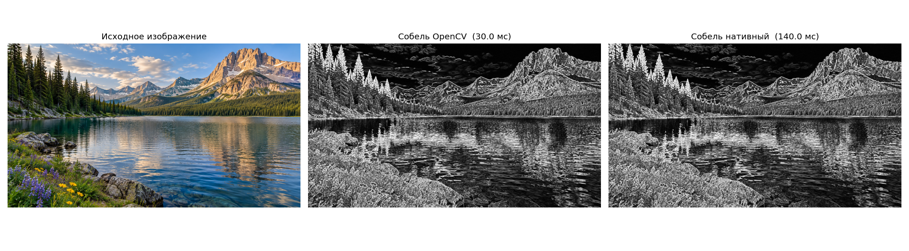
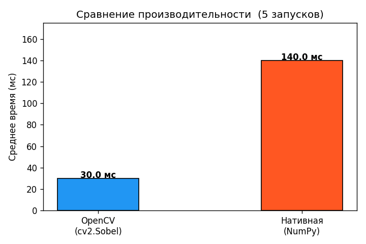

# Лабораторная работа №1 — Фильтр Собеля

**Вариант 1.** Реализация фильтра Собеля двумя способами: с использованием библиотеки OpenCV и нативно на Python (NumPy). Сравнение быстродействия.

---

## 1. Теоретическая база

### Что такое ребро на изображении

Изображение можно рассматривать как двумерную функцию `f(x, y)`, где значение — яркость пикселя. **Ребро (edge)** — это место, где яркость резко меняется: граница объектов, контуры, тени.

Математически это место с большой производной: там, где `df/dx` или `df/dy` велики — яркость скачет, то есть есть ребро.

### Дискретная производная

На изображении пиксели дискретны, поэтому вместо настоящей производной считают конечную разность:

```
df/dx ≈ f(x+1, y) − f(x−1, y)
df/dy ≈ f(x, y+1) − f(x, y−1)
```

### Оператор Собеля

Фильтр Собеля — это улучшенная версия конечной разности. Центральные соседи учитываются с весом **2**, угловые — с весом **1**. Это делает оператор менее чувствительным к шуму.

Применяется с помощью двух ядер 3×3:

**Ядро Gx** (горизонтальный градиент, реагирует на вертикальные рёбра):
```
-1   0  +1
-2   0  +2
-1   0  +1
```

**Ядро Gy** (вертикальный градиент, реагирует на горизонтальные рёбра):
```
-1  -2  -1
 0   0   0
+1  +2  +1
```

### Свёртка

Для каждого пикселя изображения берётся окно 3×3 вокруг него. Значения пикселей в окне поэлементно перемножаются с коэффициентами ядра и суммируются. Это операция **свёртки (convolution)**.

### Магнитуда градиента

После применения обоих ядер получаем два массива `grad_x` и `grad_y`. Итоговая интенсивность ребра в каждой точке — длина вектора градиента:

```
magnitude = sqrt(grad_x² + grad_y²)
```

Чем больше значение — тем ярче пиксель на выходном изображении, тем сильнее ребро.

---

## 2. Описание разработанной системы

### Структура проекта

```
├── sobel_opencv.py   — реализация через cv2.Sobel()
├── sobel_native.py   — нативная реализация вручную на NumPy
├── main.py           — загрузка изображения, запуск, сравнение, сохранение
└── image.png         — входное изображение
```

### Реализация 1 — OpenCV (`sobel_opencv.py`)

Использует встроенную функцию `cv2.Sobel()`, которая внутри реализована на C++ с SIMD-оптимизациями.

```python
def sobel_opencv(gray_image):
    grad_x = cv2.Sobel(gray_image, cv2.CV_64F, 1, 0, ksize=3)
    grad_y = cv2.Sobel(gray_image, cv2.CV_64F, 0, 1, ksize=3)
    magnitude = np.sqrt(grad_x ** 2 + grad_y ** 2)
    result = np.clip(magnitude, 0, 255).astype(np.uint8)
    return result
```

`cv2.CV_64F` — вычисления ведутся в 64-битных числах с плавающей точкой, чтобы не было переполнения (значения градиента могут выходить за пределы 0–255).

### Реализация 2 — Нативная (NumPy) (`sobel_native.py`)

Свёртка реализована вручную без вызова функций обработки изображений. Ядра применяются через сдвиги массива.

```python
def sobel_native(gray_image):
    img = gray_image.astype(np.float64)
    p = np.pad(img, pad_width=1, mode='edge')

    grad_x = (
        -1 * p[0:-2, 0:-2] + 1 * p[0:-2, 2:] +
        -2 * p[1:-1, 0:-2] + 2 * p[1:-1, 2:] +
        -1 * p[2:,   0:-2] + 1 * p[2:,   2:]
    )

    grad_y = (
        -1 * p[0:-2, 0:-2] + -2 * p[0:-2, 1:-1] + -1 * p[0:-2, 2:] +
         1 * p[2:,   0:-2] +  2 * p[2:,   1:-1] +  1 * p[2:,   2:]
    )

    magnitude = np.sqrt(grad_x ** 2 + grad_y ** 2)
    result = np.clip(magnitude, 0, 255).astype(np.uint8)
    return result
```

`np.pad(..., mode='edge')` добавляет рамку в 1 пиксель, повторяя крайние пиксели — чтобы ядро 3×3 не выходило за границу изображения. Каждое слагаемое в `grad_x` и `grad_y` — это сдвинутая версия изображения, умноженная на соответствующий коэффициент ядра Собеля.

### Алгоритм (общий для обеих реализаций)

```
Загрузить изображение
→ Перевести в оттенки серого (1 канал)
→ Применить ядро Gx → grad_x
→ Применить ядро Gy → grad_y
→ magnitude = sqrt(grad_x² + grad_y²)
→ Обрезать в [0, 255]
→ Сохранить результат
```

---

## 3. Результаты работы и тестирования

**Тестовое изображение:** горный пейзаж, 1920×1080 пикселей.

### Визуальный результат



Фильтр чётко выделяет контуры гор, деревьев, отражений в воде и камней. Результаты обеих реализаций визуально идентичны.

### Сравнение производительности

Каждый метод запускался **5 раз**, результат усреднялся.



| Реализация | Среднее время |
|---|---|
| OpenCV (`cv2.Sobel`) | 30 мс |
| Нативная (NumPy) | 140 мс |
| Ускорение OpenCV | **~4.7×** |

### Точность результатов

| Метрика | Значение |
|---|---|
| Максимальное расхождение | 241 / 255 |
| Среднее расхождение | 0.037 / 255 |

Максимальное расхождение в 241 появляется только у единичных **граничных пикселей**: OpenCV по умолчанию использует зеркальное дополнение границы (BORDER_REFLECT_101), тогда как в нативной реализации применяется копирование крайних пикселей (`mode='edge'`). Среднее расхождение 0.037 говорит о том, что на 99.9% изображения результаты совпадают.

---

## 4. Выводы

1. Фильтр Собеля эффективно выделяет границы объектов — контуры гор, деревьев, отражений хорошо видны на результирующем изображении.

2. Нативная реализация на NumPy работает медленнее OpenCV примерно в **4.7 раза** на изображении 1920×1080. Это объясняется тем, что OpenCV использует скомпилированный C++ код с SIMD-инструкциями (SSE/AVX), позволяющими обрабатывать несколько пикселей за один такт процессора.

3. При этом нативная реализация не использует никаких специализированных функций обработки изображений — только базовые операции над массивами NumPy — и тем не менее даёт **практически идентичный результат** (среднее отклонение менее 0.04 пикселя из 255).

4. Небольшое расхождение по краям изображения обусловлено разным способом дополнения границ, а не ошибкой в алгоритме.

---

## 5. Использованные источники

1. Документация OpenCV — [`cv2.Sobel`](https://docs.opencv.org/4.x/d4/d86/group__imgproc__filter.html#gacea54f142e81b6758cb6f375ce782c8d)
2. Документация NumPy — [`numpy.pad`](https://numpy.org/doc/stable/reference/generated/numpy.pad.html)
